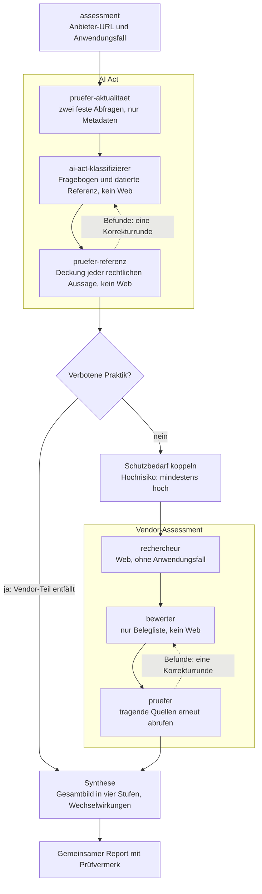

# AI Vendor Assessment

> Status: Version 0.1.0. Beide Module und der gemeinsame Einstiegspunkt sind lauffähig und in Blindtests erprobt. Eine unabhängige fachliche Prüfung der Soll-Werte steht aus. **Keine Rechtsberatung**, siehe [Haftungshinweis](#haftungshinweis).

Ein Plugin für [Claude Code](https://code.claude.com/docs) mit zwei Aufgaben aus der Informationssicherheit und AI Governance:

1. **Vendor-Security-Assessment:** bewertet einen Software- oder Cloud-Anbieter anhand öffentlicher Quellen nach einem Ampel-Schema. Jede Aussage im Report ist mit Quelle und wörtlicher Belegstelle verlinkt. Ohne Beleg lautet der Status „nicht belegt“.
2. **EU-AI-Act-Ersteinschätzung:** ordnet einen KI-Anwendungsfall per Fragebogen einer Risikoklasse zu und listet die Pflichten der Organisation mit Geltungsbeginn sowie offene Punkte. Rechtsinhalte stammen ausschließlich aus einer datierten Referenz zur konsolidierten Fassung des AI Act, einschließlich des Digital Omnibus on AI (Verordnung (EU) 2026/1744).

Der Einstiegspunkt `assessment` verbindet beide Module zu einer Frage: *Kann dieser Dienst für diesen Anwendungsfall eingesetzt werden?* Er erzeugt einen gemeinsamen Report mit einem vierstufigen Gesamtbild (nicht zulässig, zwingend zu klären, mit Klärungen möglich, keine Hindernisse festgestellt), den Wechselwirkungen zwischen beiden Modulen und priorisierten offenen Punkten.

Ein unveränderter Beispielreport mit beiden Prüfberichten liegt unter [`examples/`](examples/).

## Installation

Voraussetzungen:

- Claude Code (Terminal, Desktop-App oder IDE-Erweiterung). In Cloud-Sessions werden lokal installierte Plugins nicht geladen.
- Empfohlen: das Plugin `playwright` aus dem offiziellen Marktplatz. Rechercheur und Prüfer brauchen es für Trust Center, die ihre Inhalte per JavaScript laden. Ohne das Plugin arbeiten sie nur mit Websuche und Webabruf und finden dort entsprechend weniger Belege.

In einer Claude-Code-Session:

```text
/plugin marketplace add OWNER/REPO
/plugin install ai-vendor-assessment@ai-vendor-assessment
/plugin install playwright@claude-plugins-official
```

Oder in der Shell:

```bash
claude plugin marketplace add OWNER/REPO
```

```bash
claude plugin install ai-vendor-assessment@ai-vendor-assessment
```

Vor der Installation zeigt `/plugin` an, was das Plugin mitbringt: drei Skills und sechs Subagents, keine Hooks und keine MCP-Server. Laut `claude plugin details` kostet das Plugin etwa 690 Tokens in jeder Session, in der es aktiv ist. Jeder Aufruf eines Skills oder Subagents kostet zusätzlich etwa 600 bis 1.300 Tokens für dessen Anweisungen, dazu kommt die eigentliche Arbeit (Recherche, Bewertung, Prüfung).

Aktualisieren: Automatische Updates sind für Marktplätze außerhalb von Anthropic standardmäßig aus. Sie lassen sich in `/plugin` im Reiter **Marketplaces** einschalten. Manuell:

```bash
claude plugin update ai-vendor-assessment@ai-vendor-assessment
```

Entfernen:

```bash
claude plugin marketplace remove ai-vendor-assessment
```

Das entfernt den Marktplatz und deinstalliert das Plugin. Bereits erzeugte Reports bleiben in den Projektordnern liegen.

## Nutzung

Die Skills tragen den Namen des Plugins als Präfix. Claude Code im eigenen Projektordner starten, dann:

**Gesamtbewertung (beide Module):**

```text
/ai-vendor-assessment:assessment <anbieter-url> "Beschreibung des Anwendungsfalls" ["Tarif"] [dialog|test]
```

- Die AI-Act-Einstufung läuft zuerst, danach das Vendor-Assessment.
- Ergibt der AI Act „Hochrisiko“, wird der Schutzbedarf für die Anbieterbewertung auf mindestens „hoch“ gesetzt.
- Bei einer verbotenen Praktik entfällt das Vendor-Assessment.
- Regeln: [`schema/gesamtbild.yaml`](plugins/ai-vendor-assessment/schema/gesamtbild.yaml).

**Vendor-Assessment allein:**

```text
/ai-vendor-assessment:vendor-assessment <anbieter-url> [normal|hoch|sehr_hoch] ["Anwendungsfall"] ["Tarif"]
```

Beispiele:

```text
/ai-vendor-assessment:vendor-assessment https://www.example.com
/ai-vendor-assessment:vendor-assessment https://www.example.com "" "Personalverwaltung inkl. Krankheitsdaten"
/ai-vendor-assessment:vendor-assessment https://www.example.com hoch "" "Business"
```

- Ohne Schutzbedarf und Anwendungsfall gilt „normal“.
- Mit Anwendungsfall, aber ohne Schutzbedarf, leitet der Skill den Schutzbedarf her und legt die Herleitung offen.
- Ohne Tarif wird der kleinste kostenpflichtige Business-Tarif bewertet.

**AI-Act-Ersteinschätzung allein:**

```text
/ai-vendor-assessment:ai-act-check "Beschreibung des Anwendungsfalls" [dialog|test]
```

- Im Modus `dialog` (Standard) leitet der Skill ab, was aus der Beschreibung hervorgeht, legt die Annahmen zur Bestätigung vor und fragt den Rest mit Auswahloptionen ab.
- Im Modus `test` stellt er keine Rückfragen. Was sich nicht ableiten lässt, wird „unklar“.

### Wo die Ergebnisse landen

Alle Ergebnisse bleiben auf dem eigenen Rechner, im Projektordner, in dem Claude Code gestartet wurde:

| Pfad | Inhalt |
|---|---|
| `reports/<lauf-id>.md` | Report |
| `reports/_arbeit/<lauf-id>/` | Zwischenergebnisse: Belegliste, Aktualitätsprüfung, Prüfberichte |
| `.playwright-mcp/` | Protokolle des Playwright-Plugins, falls installiert. Diesen Ordner legt Playwright an, nicht dieses Plugin |

Das Plugin lädt nichts hoch und schreibt nichts in dieses Repository. Wer den eigenen Projektordner mit Git versioniert, sollte `reports/` und `.playwright-mcp/` in die `.gitignore` aufnehmen, sonst landen Reports und Browser-Protokolle beim nächsten Push im eigenen Repository.

## Wie die Bewertung funktioniert

Das Schema in [`criteria.yaml`](plugins/ai-vendor-assessment/schema/criteria.yaml) trennt zwei Ebenen:

- **Einzelbewertung:** neun Kriterien, unabhängig vom Anwendungsfall: Zertifizierungen, Hosting und Datenresidenz, Subprozessoren, Auftragsverarbeitung, Authentifizierung, Incidents, Verschlüsselung, Schwachstellenmanagement, Nutzung von Kundendaten durch KI. Status Grün, Gelb, Rot, nicht belegt oder nicht anwendbar, jeweils mit Belegstufe (A Primärnachweis, B Selbstauskunft des Anbieters, C Drittquelle).
- **Gesamturteil:** abhängig vom Schutzbedarf des Anwendungsfalls (normal, hoch, sehr hoch, angelehnt an den BSI IT-Grundschutz). Ein höherer Schutzbedarf macht mehr Kriterien zu Kernkriterien und verschärft die Anforderungen. Schließt der Vertrag des Anbieters eine Datenart aus, die der Anwendungsfall enthält, ist das Ergebnis „Rot – vertraglich unzulässig“.

Rot setzt einen belegten Mangel voraus. Fehlende Informationen ergeben „nicht belegt“, nicht Rot.

Der AI-Act-Fragebogen in [`ai-act-fragebogen.yaml`](plugins/ai-vendor-assessment/schema/ai-act-fragebogen.yaml) trennt drei Ebenen:

- **Einstufung:** Anwendungsbereich, Rolle, Verbote, Hochrisiko, Transparenz. Jede Antwort mit Fundstelle.
- **Sicherheit:** bestätigt, vorläufig oder offen, je nachdem, ob die tragenden Antworten bestätigt, aus der Beschreibung abgeleitet oder unklar sind.
- **Dringlichkeit:** welche Pflichten bereits gelten und welche erst ab einem Datum.

„Unklar“ wird nie als „nein“ gewertet und führt nicht automatisch zur strengeren Klasse, sondern zu einem offenen Punkt mit Klärungsauftrag. Jede Frage hat eine Erklärung in Alltagssprache und je ein Ja- und Nein-Beispiel, damit auch Fachabteilungen ohne Vorwissen den Fragebogen beantworten können.

## Architektur: Funktionstrennung mit Subagents

Ablauf von `assessment`. `ai-act-check` und `vendor-assessment` führen jeweils nur ihren Teil aus.



Die Skills führen die Arbeit nicht selbst aus. Sie beauftragen Subagents mit getrennten Werkzeugrechten, nach dem Prinzip der geringsten Rechte. Die Rechte stehen im Feld `tools` der jeweiligen Datei und gelten technisch, nicht nur als Anweisung.

| Subagent | Aufgabe | Webzugriff | Datei |
|---|---|---|---|
| `pruefer-aktualitaet` | Prüfen, ob die AI-Act-Referenz dem neuesten veröffentlichten Rechtsstand entspricht | nur Abruf, laut Anweisung nur zwei feste URLs | [`pruefer-aktualitaet.md`](plugins/ai-vendor-assessment/agents/pruefer-aktualitaet.md) |
| `ai-act-klassifizierer` | AI-Act-Einstufung nach Fragebogen | nein | [`ai-act-klassifizierer.md`](plugins/ai-vendor-assessment/agents/ai-act-klassifizierer.md) |
| `pruefer-referenz` | Deckung jeder rechtlichen Aussage durch die Referenz prüfen | nein | [`pruefer-referenz.md`](plugins/ai-vendor-assessment/agents/pruefer-referenz.md) |
| `rechercheur` | Belege zum Anbieter sammeln, mit wörtlicher Belegstelle | ja | [`rechercheur.md`](plugins/ai-vendor-assessment/agents/rechercheur.md) |
| `bewerter` | Ampel je Kriterium, nur aus der Belegliste | nein | [`bewerter.md`](plugins/ai-vendor-assessment/agents/bewerter.md) |
| `pruefer` | Deckung jeder Aussage prüfen, tragende Quellen erneut abrufen | nur Abruf | [`pruefer.md`](plugins/ai-vendor-assessment/agents/pruefer.md) |

- Der Rechercheur erhält weder Anwendungsfall noch Schutzbedarf. Diese Angaben können deshalb nicht in Suchanfragen gelangen.
- Der Bewerter kann nicht nachrecherchieren. Was nicht in der Belegliste steht, ist „nicht belegt“.
- Die Prüfer ändern keinen Report. Bei Befunden gibt es genau eine Korrekturrunde, danach werden verbliebene Befunde im Report als Prüfvermerk ausgewiesen.
- Die Zwischenergebnisse unter `reports/_arbeit/` machen jeden Schritt nachvollziehbar.

## Aktualität der Rechtsgrundlage

Die AI-Act-Einstufung stützt sich nur auf [`references/eu-ai-act.md`](plugins/ai-vendor-assessment/references/eu-ai-act.md), Stand 26.10.2026, ergänzt 27.10.2026 (konsolidierte Fassung CELEX `02024R1689-20260727`). Damit ein Report nicht unbemerkt auf veraltetem Recht beruht, fragt der Subagent `pruefer-aktualitaet` vor jeder Einstufung beim SPARQL-Dienst des Amts für Veröffentlichungen der EU ab, ob es eine neuere konsolidierte Fassung oder einen neuen Änderungsrechtsakt gibt. Die Beschreibung des Anwendungsfalls erhält er nicht.

| Ergebnis | Folge im Report |
|---|---|
| `aktuell` | Zeile „Aktualität der Referenz“ mit Prüfdatum |
| `veraltet` | Hinweis zum Rechtsstand vor der Kopfzeile, Sicherheit höchstens „vorläufig“, erster offener Punkt: Referenz aktualisieren und Einstufung wiederholen |
| `nicht_geprueft` (Abfrage fehlgeschlagen) | Zeile mit Grund und Alter der Referenz. Ist die Referenz älter als drei Monate, zusätzlich der Hinweis und Sicherheit höchstens „vorläufig“ |

Der Lauf bricht in keinem Fall ab. Grenzen der Prüfung:

- Sie erkennt nur neue konsolidierte Fassungen und Änderungsrechtsakte der Verordnung. Leitlinien der Kommission, Berichtigungen ohne neue konsolidierte Fassung, delegierte Rechtsakte, Normen und nationale Vorschriften erfasst sie nicht.
- Sie sagt, *dass* sich etwas geändert hat, nicht *was*. Die Referenz aktualisiert der Maintainer von Hand, mit Recherche und neuem Stand-Datum.

## Sicherheitshinweise

- **Webzugriff ohne Einzelbestätigung.** Rechercheur und Prüfer rufen während eines Laufs Webseiten und Suchen ab. Abgerufene Inhalte gelten laut Anweisung als Daten, nicht als Anweisungen. Ein verlässlicher Schutz gegen Prompt Injection ist das nicht.
- ⚠️ **Webabruf im AI-Act-Teil.** Eine Werkzeugsperre im Skill (`disallowed-tools`) gilt auch für alle Subagents, die er beauftragt. Weil die Aktualitätsprüfung Webabruf braucht, sperrt `ai-act-check` nur die Websuche. Dass der Hauptagent selbst keine Webseiten abruft, ist damit nur eine Anweisung, keine technische Sperre. Klassifizierer und Referenz-Prüfer haben technisch keinen Webzugriff. Dass die Aktualitätsprüfung nur die zwei festen URLs abruft, ist ebenfalls nur eine Anweisung.
- **Datenminimierung.** Suchanfragen enthalten nur Anbieter und Kriterium, nie Angaben zum Anwendungsfall. Im beruflichen Kontext kann schon die Information „Anbieter X wird geprüft“ vertraulich sein.
- **Beschreibungen sind Daten.** Die Beschreibung des Anwendungsfalls wird als Daten behandelt, nicht als Anweisung. Vertrauliche Details gehören trotzdem nicht hinein: Sie werden an das Sprachmodell übertragen und stehen im Report.

## Qualitätssicherung

### Eval-Suite für den AI-Act-Teil

Zehn erfundene Testfälle mit Soll-Einstufung in [`evals/ai-act-testfaelle.md`](evals/ai-act-testfaelle.md), Soll-Werte in [`evals/soll.yaml`](evals/soll.yaml). Jeder Fall läuft als Blindtest in einer frischen Session. Ein Skript vergleicht den Report mit dem Soll-Wert:

```bash
ruby evals/auswerten.rb 9=reports/<report>.md
```

| Stand 27.10.2026 | Ergebnis |
|---|---|
| Gezählte Läufe während der Entwicklung | 15 von 15 Risikoklassen getroffen, 15 von 15 mit Fundstelle |
| Grenzfälle Verbot und Hochrisiko (Fälle 4, 9, 10) | je 3 Läufe, 9 von 9 getroffen |
| Läufe mit dem installierten Plugin | Fall 9 (verboten) und Fall 10 (Hochrisiko), beide getroffen, nach der Korrekturrunde keine Aussage „teilweise“ oder „nicht gedeckt“ |

Was die Zahlen nicht aussagen:

- Die Soll-Werte sind eigene Hypothesen und nicht juristisch geprüft. Gemessen wird Übereinstimmung mit dieser Lesart, nicht Richtigkeit.
- Nur die Grenzfälle liefen mehrfach. Die übrigen Fälle liefen je einmal, teils auf älteren Fragebogen-Versionen und einem anderen Modell.
- Die Klasse ist stabil, die Begründung nicht: Die Zahl der nur teilweise gedeckten Aussagen schwankt zwischen Läufen desselben Falls (z. B. 0 gegenüber 6).

### Vendor-Assessment und Gesamtbewertung

- **Vendor-Assessment:** Während der Entwicklung liefen Tests mit drei realen Anbietern und allen drei Schutzbedarfsstufen, mit dem installierten Plugin ein weiterer Lauf (gleiches Ergebnis wie im Vorlauf). Die Ergebnisse sind nicht veröffentlicht und nicht gegen die Quellen geprüft. Mehrfachläufe fehlen, weil jeder Lauf eine vollständige Web-Recherche braucht.
- **Gesamtbewertung:** zwei Läufe zu einem Fall vor der Umstellung auf das Plugin. Lauf 1 traf die Erwartung, Lauf 2 lag bei der vorab als vertretbar festgelegten Abweichung. ⚠️ Mit dem installierten Plugin ist `assessment` noch nicht eigens getestet. Es nutzt dieselben Subagents wie die beiden getesteten Skills.

## Projektstruktur

| Pfad | Inhalt |
|---|---|
| [`.claude-plugin/marketplace.json`](.claude-plugin/marketplace.json) | Marktplatz mit diesem einen Plugin |
| [`plugins/ai-vendor-assessment/`](plugins/ai-vendor-assessment/) | Das Plugin |
| ↳ [`skills/`](plugins/ai-vendor-assessment/skills/) | `assessment`, `vendor-assessment` (mit Quellen-Leitfaden), `ai-act-check` |
| ↳ [`agents/`](plugins/ai-vendor-assessment/agents/) | Die sechs Subagents |
| ↳ [`schema/`](plugins/ai-vendor-assessment/schema/) | Kriterien, Fragebogen, Regeln für das Gesamtbild, Report-Vorlagen |
| ↳ [`references/eu-ai-act.md`](plugins/ai-vendor-assessment/references/eu-ai-act.md) | Datierte Referenz zum AI Act, einzige Rechtsgrundlage der Einstufung |
| [`evals/`](evals/) | Testfälle, Soll-Werte, Auswertungsskript |
| [`examples/`](examples/) | Beispielreport mit Prüfberichten und Hinweis zur Auswahl |
| [`.claude/hooks/`](.claude/hooks/) | Hook für Mitwirkende, siehe [CONTRIBUTING](CONTRIBUTING.md) |

## Mitwirken

Hinweise zu Änderungen, Tests und dem Hook für den YAML-Kopf: [CONTRIBUTING.md](CONTRIBUTING.md).

## Haftungshinweis

Dieses Plugin liefert eine automatisierte Ersteinschätzung auf Basis öffentlich zugänglicher Informationen. Es ist **keine Rechtsberatung** und ersetzt weder eine juristische Prüfung noch ein vollständiges Lieferanten-Audit.

- Ergebnisse können unvollständig, falsch oder veraltet sein und sind vor jeder Verwendung fachlich zu prüfen.
- Die AI-Act-Einstufung beruht ausschließlich auf der datierten Referenz in [`references/eu-ai-act.md`](plugins/ai-vendor-assessment/references/eu-ai-act.md). Die Aktualitätsprüfung erkennt neue Fassungen der Verordnung, aber keine neuen Leitlinien der Kommission und keine nationalen Vorschriften. Eigene Auslegungen sind in der Referenz als solche gekennzeichnet.
- Die Soll-Werte der Eval-Suite sind nicht juristisch geprüft.
- Dieses Repository enthält keine Bewertung namentlich genannter Anbieter. Mit dem Plugin erzeugte Reports sind keine Aussage des Maintainers über den jeweiligen Anbieter.

## Lizenz

[MIT](LICENSE) © 2026 Clemens Fetzer
